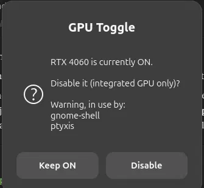

# ASUS TUF F15 (FX507VV) on Linux: Suspend/Wake Fix + GPU Toggle

Two fixes for running Ubuntu (or another Linux) on an **ASUS TUF F15** with an NVIDIA GPU and a MUX switch:

1. **Suspend/wake fix** – the laptop goes to sleep (`s2idle` / Modern Standby) but never wakes from the lid, power button or keyboard. An ACPI SSDT override fixes the missing wake definition in the ASUS BIOS.
2. **GPU Toggle** – a one-click app that turns the NVIDIA dGPU on or off from Ubuntu, like Armoury Crate does in Windows, with a confirmation prompt so an accidental click can't switch it.

**Tested on:** `ASUS TUF Gaming F15 FX507VV` (RTX 4060), Ubuntu 26.04 LTS, kernel 7.0.0-43-generic, GNOME on Wayland.
Other TUF F15 / FX507-series laptops with the same BIOS bug should behave the same, but only the machine above has been tested. Everything here changes boot files (GRUB, initrd) and system services, so read the scripts first and use at your own risk.

---

## Part 1: Suspend/wake fix

### Do you have this bug?

* The laptop suspends normally (screen off, fans stop), but pressing the power button, a key, or opening the lid does nothing. You have to hold the power button to restart.
* `grep LID0 /proc/acpi/wakeup` prints **nothing**.
* The log ends at `PM: suspend entry (s2idle)` with no error and no resume lines:
  `journalctl -b -1 --no-pager | grep -iE 'PM:|suspend' | tail`

### Why it happens

On this laptop the lid, power button and internal keyboard wake the CPU through the embedded controller on **GPE 0x02**. The BIOS defines the lid device `LID0` but omits its `_PRW` (power resources for wake) entry. Linux therefore finds no wake source on that GPE and disarms it before entering `s2idle`, so wake events never arrive.

The fix is a 93-byte SSDT table that adds the missing `_PRW` to `\_SB.PC00.LPCB.LID0`, loaded at boot from an early initrd.

### Install (beginner-friendly)

1. Open a terminal (`Ctrl` + `Alt` + `T`).
2. Download the repo:
   ```bash
   cd ~ && git clone https://github.com/GM-Hrishi/asus-tuf-linux-sleep-fix.git
   cd asus-tuf-linux-sleep-fix
   ```
3. Run the installer as your normal user (it asks for your password when needed):
   ```bash
   ./install.sh
   ```
   It installs `acpica-tools` and `cpio`, checks that your BIOS has the `LID0` device, compiles the patch, packs it into `/boot/acpi_override.cpio`, backs up `/etc/default/grub`, adds `GRUB_EARLY_INITRD_LINUX_CUSTOM="acpi_override.cpio"`, and runs `update-grub`.
4. Reboot:
   ```bash
   sudo reboot
   ```

### Verify

```bash
grep LID0 /proc/acpi/wakeup
```

Expected output:

```
LID0   S0   *enabled   platform:PNP0C0D:01
```

Then suspend and wake the laptop.

### Make sure you are using `s2idle`

```bash
cat /sys/power/mem_sleep      # expect: [s2idle] deep
```

If it shows `[deep]`, add `mem_sleep_default=s2idle` to `GRUB_CMDLINE_LINUX_DEFAULT` in `/etc/default/grub`, run `sudo update-grub`, and reboot.

### Uninstall

```bash
./uninstall.sh
```

---

## Part 2: GPU Toggle (turn the NVIDIA GPU on/off from Ubuntu)



### What it does

* Adds a **GPU Toggle** icon to your app grid (pin it to the dock).
* Opening it shows whether the dGPU is ON or OFF and asks before flipping it, in either direction. Nothing changes without a confirmation.
* When disabling, it lists any programs currently using the NVIDIA GPU.
* When enabling, it also loads the NVIDIA driver and waits for the GPU to appear.
* A small systemd service **re-enables the GPU on every shutdown or reboot**, so the next OS (Windows) never starts with it off.

Under the hood it flips the same firmware flag as Armoury Crate's **Eco mode** (`dgpu_disable`). It does not change the MUX switch.

### Requirements

* An ASUS laptop whose kernel exposes one of:
  * `/sys/class/firmware-attributes/asus-armoury/attributes/dgpu_disable/current_value` (newer kernels), or
  * `/sys/devices/platform/asus-nb-wmi/dgpu_disable` (older kernels; this path is supported but untested here)
* Ubuntu with GNOME (uses `zenity` and `notify-send`)
* The proprietary NVIDIA driver installed and working

### Install

```bash
cd ~/asus-tuf-linux-sleep-fix/gpu-toggle
./install.sh
```

Then open **Show Apps** (the grid of dots in the dock), find **GPU Toggle**, and right-click it, then **Add to Favorites**.

The installer adds a passwordless `sudo` rule for one small root helper, `/usr/local/sbin/gpu-set`, which only accepts `on`, `on-load` or `off`. That is why the confirmation dialog is the only gate. Read `gpu-toggle/gpu-set` if you want to see exactly what it can do.

### Use

Click **GPU Toggle**, then confirm. You get a notification when it is done. Check from a terminal with:

```bash
nvidia-smi -L
```

### Uninstall

```bash
cd ~/asus-tuf-linux-sleep-fix/gpu-toggle
./uninstall.sh
```

### Dual boot with Windows

In Windows, set Armoury Crate to **Standard**. If Armoury Crate is saved in **Eco** mode it disables the GPU at every Windows boot, whatever Linux did.

### Known limitations

* Disabling the GPU while the NVIDIA driver is in use (for example `nvidia-persistenced` or the desktop using it) leaves the driver attached to a removed GPU. The kernel logs `Attempting to remove device ... with non-zero usage count`. Disable the GPU right after boot or when nothing is using it, and test suspend from a clean boot.
* If the machine is force-powered-off or crashes, the shutdown hook does not run and the GPU stays in whatever state it was in.

---

## NVIDIA suspend settings and troubleshooting

* [docs/nvidia-suspend-settings.md](docs/nvidia-suspend-settings.md) – the NVIDIA/GRUB settings that gave working suspend and wake with the GPU on.
* [docs/troubleshooting.md](docs/troubleshooting.md) – missing NVIDIA module after a kernel update, `nvidia-smi` showing no devices, Windows turning the GPU off, wake fix not applying.

## Tried it on a different model? Please report

Open an issue and include:

* the output of `cat /sys/class/dmi/id/product_name`
* your Ubuntu version and kernel (`uname -r`)
* the output of `grep LID0 /proc/acpi/wakeup` before and after the fix
* whether suspend and wake worked afterwards

That is how this repo learns which other TUF models the fix works on.

## Repo layout

```
ssdt-lidwake.asl     ACPI patch source
install.sh           sleep-fix installer
uninstall.sh         sleep-fix uninstaller
gpu-toggle/          GPU Toggle app (helper, UI script, service, installer)
docs/                NVIDIA settings, troubleshooting, screenshots
```

## Keywords

asus tuf f15 fx507vv ubuntu suspend fix, asus tuf won't wake up from sleep linux, asus tuf modern standby wake bug, acpi wakeup LID0 _PRW s2idle, asus tuf f15 enable disable nvidia gpu ubuntu, asus eco mode linux, dgpu_disable asus-armoury.
